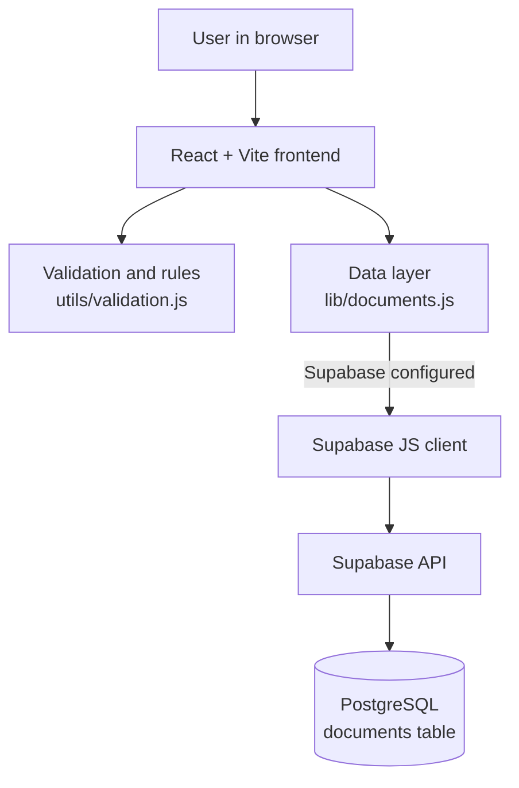
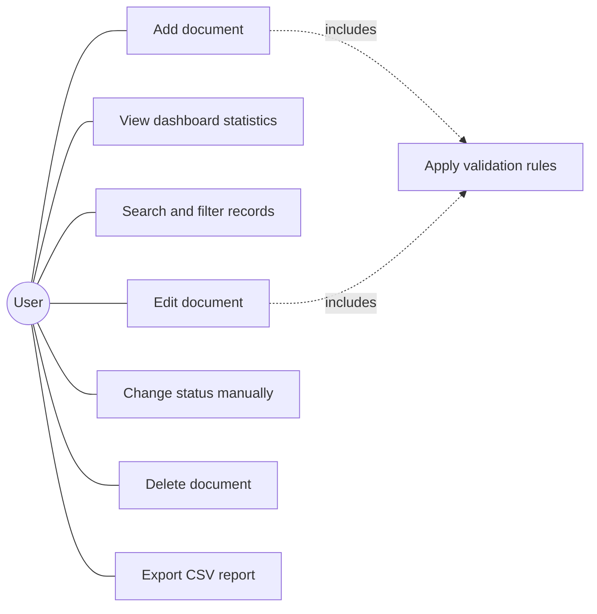
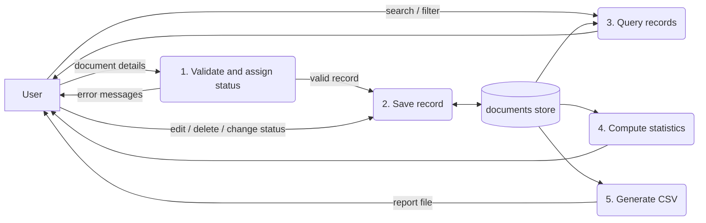
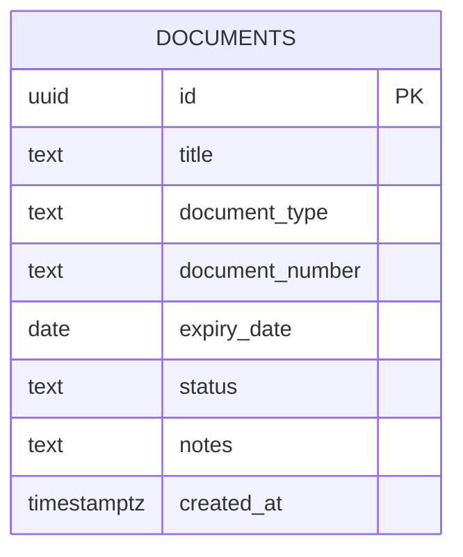

# IntelliDoc AI: Project Report (Draft)

> **How to use this draft.** Anything in **[FILL IN: ...]** must be completed by you. Do not invent results, screenshots, citations or signatures. If SAL College gave you a report template, copy this content into that template instead.

---

## 1. Cover Page

**Project title:** IntelliDoc AI: AI-Powered Document Review and Management System

**Submitted in partial fulfilment of the requirements for the degree of Master of Computer Applications (MCA), Semester 5**

**Submitted by:** [FILL IN: your full name]
**Enrolment / Roll number:** [FILL IN]
**Project guide:** [FILL IN: guide's name and designation]
**Institute:** SAL College, Ahmedabad, Gujarat, India
**University:** [FILL IN: affiliated university]
**Academic year:** [FILL IN: e.g. 2026-27]

---

## 2. Certificate Page (blank template)

This is to certify that **[FILL IN: student name]**, Enrolment No. **[FILL IN]**, has carried out the project work entitled **"IntelliDoc AI: AI-Powered Document Review and Management System"** in partial fulfilment of the requirements for the MCA programme, Semester 5, at SAL College, Ahmedabad.

Project Guide: ______________________ (Signature) Date: __________

Head of Department: ______________________ (Signature) Date: __________

External Examiner: ______________________ (Signature) Date: __________

*(Signatures and approvals are to be obtained from the college. Leave blank until then.)*

---

## 3. Acknowledgement

[FILL IN: write this in your own words. Typical content: thank your project guide, the faculty and HOD of the MCA department at SAL College, and your family and friends for their support.]

---

## 4. Abstract

Organizations and educational institutions often keep document records manually, which makes it hard to track details, review statuses, spot expired documents, search records and prepare reports. IntelliDoc AI is a web application that centralizes document records. Users can register documents, and the system applies simple rules: records with missing required details are rejected at entry, and documents whose expiry date has passed are marked Rejected, while others are marked Verified by default. Users can change statuses manually, search and filter records, edit and delete them, view live dashboard statistics, and export records to CSV. The application is built with React and Vite on the front end and Supabase (PostgreSQL) for storage. The system is a rule-based record-management prototype and does not establish the authenticity of documents.

---

## 5. Table of Contents

[FILL IN: generate automatically in Word (References -> Table of Contents) after you apply Heading styles, so the page numbers are correct.]

---

## 6. Introduction

Document records such as certificates, invoices, permits and academic records are needed in almost every organization. When they are tracked in paper registers or scattered spreadsheets, finding a record, checking whether it has expired, or producing a report takes time and invites mistakes. IntelliDoc AI is a small web-based system that keeps these records in one place, applies consistent basic checks, and gives a clear overview through a dashboard.

## 7. Problem Statement

Manual document-record keeping makes it difficult to track document details, review statuses, identify expired documents, search records and prepare reports. IntelliDoc AI aims to simplify this through a centralized web application that manages document records, applies basic validation rules, tracks verification statuses and exports reports. It is a document-management and rule-based verification prototype and does not claim to prove the authenticity of documents.

## 8. Objectives

- Provide a centralized interface for document records.
- Allow users to register document details.
- Validate required fields and expiry dates.
- Assign basic verification statuses (Pending, Verified, Rejected).
- Show summary statistics on a dashboard.
- Support searching and filtering.
- Allow editing and deleting records.
- Export records as a CSV report.
- Store records persistently in a Supabase PostgreSQL database.

## 9. Scope and Limitations

**In scope:** single-organization record management; fields: title, type, number, expiry date, status, notes; rule-based status assignment; dashboard; search/filter; CRUD; CSV export; Supabase PostgreSQL storage.

**Out of scope (MVP):** user login and roles, file/document upload, OCR, AI-based verification, audit logs, email notifications, multi-organization support.

## 10. Software and Hardware Requirements

**Software**

| Item | Version used |
|---|---|
| Operating system | [FILL IN: e.g. Windows 11] |
| Node.js / npm | 20 or newer ([FILL IN: your version from `node -v`]) |
| Web browser | Chrome / Edge / Firefox (current) |
| Code editor | [FILL IN: e.g. VS Code] |
| Database service | Supabase (free tier), PostgreSQL |

**Hardware (minimum):** [FILL IN: e.g. dual-core processor, 4 GB RAM, 1 GB free disk space, internet connection for Supabase and package installation].

## 11. Technology Stack

| Layer | Technology | Why |
|---|---|---|
| UI library | React | Component-based UI; state drives what is shown |
| Build tool | Vite | Fast dev server and production build |
| Language | JavaScript (ES modules) | Simple, no compile step beyond Vite |
| Styling | Plain CSS | No extra setup; full control |
| Icons | Lucide React | Consistent open-source icons |
| Backend / DB | Supabase + PostgreSQL | Hosted database with an automatic REST API, free tier |
| Client library | @supabase/supabase-js | Official JavaScript client |

## 12. System Architecture

The UI only talks to the data layer (`documents.js`), which performs the four CRUD operations through the Supabase client. If a call fails, a readable error is shown. If the environment variables are missing, a setup screen is shown instead of the dashboard.

## 13. Use-Case Diagram

(Redraw as a standard UML use-case diagram with an actor and system boundary in draw.io or similar if your college requires UML notation.)

## 14. Data Flow Diagram

**Level 0 (context):** User -> [IntelliDoc AI] -> User, with the data store *documents* attached. The user sends document details and commands; the system returns records, statistics and CSV files.

**Level 1:**

## 15. Database Schema and ER Diagram

Table **documents**

| Column | Type | Constraint |
|---|---|---|
| id | UUID | Primary key, default `gen_random_uuid()` |
| title | TEXT | NOT NULL, not blank |
| document_type | TEXT | NOT NULL, not blank |
| document_number | TEXT | NOT NULL, not blank |
| expiry_date | DATE | Nullable |
| status | TEXT | NOT NULL, default 'Pending', CHECK in ('Pending','Verified','Rejected') |
| notes | TEXT | Nullable |
| created_at | TIMESTAMPTZ | NOT NULL, default `now()` |

Indexes: status, created_at (descending), expiry_date. Row Level Security is enabled with demo policies (see `supabase.sql`).

Because the MVP has a single entity, the ER diagram has one table. In a future version with login, a `users` entity would be related one-to-many to `documents`.

## 16. Module Descriptions

1. **Dashboard module:** statistic cards (total, verified, pending, rejected) computed from the loaded records; recent records list.
2. **Document registration module:** the add/edit form with required-field validation and a live rule preview.
3. **Rule-based verification module:** `validation.js`; decides Verified or Rejected from completeness and expiry; allows manual override.
4. **Document management module:** table with search, status filter, inline status change, edit, delete with confirmation, loading/empty/error states.
5. **Export module:** `csv.js`; builds a correctly escaped CSV of the currently displayed records and downloads it.
6. **Storage module:** `documents.js` and `supabase.js`; the same four operations (list, create, update, delete) against the Supabase `documents` table.

## 17. Implementation Details

- **State:** React `useState` holds records, search text, filter, open dialogs and messages; `useMemo` derives statistics and the filtered list so they are always consistent with the data.
- **Expiry check:** dates are compared as `YYYY-MM-DD` text using the user's local date, which avoids timezone off-by-one errors. A document expiring today is still valid.
- **Saving:** the UI updates and shows a success message only after the database call succeeds. A failed update never creates a duplicate.
- **Search:** case-insensitive match on title, type, number and status.
- **CSV:** fields with commas, quotes or line breaks are quoted and quotes doubled; a leading `'` is added to values starting with `=`, `+`, `-`, `@` to prevent spreadsheet formula injection; a UTF-8 BOM is added for Excel.
- **Configuration:** `VITE_SUPABASE_URL` and `VITE_SUPABASE_ANON_KEY` are read from `.env`; if missing or still placeholders, the app shows a setup screen.
- **Security:** only the public (anon/publishable) key is used in the browser. RLS is on; demo policies are open and must be replaced before real use.

[FILL IN: add 2-3 short code snippets you can explain, e.g. `validateDocument`, `escapeCsvCell`, `listDocuments`.]

## 18. Testing Methodology and Test Cases

Approach: automated unit tests for the logic (`npm test`) plus manual functional tests of the user interface and database. Use the table in `docs/TEST_PLAN.md` and copy your own results here.

[FILL IN: paste the completed test table with your actual results and Pass/Fail. Only record what you actually observed.]

## 19. Results and Screenshots

[FILL IN: insert your own screenshots with captions, for example: dashboard overview; add-document form with validation errors; expired document marked Rejected; search and filter; CSV opened in Excel; Supabase Table Editor showing the rows; mobile view.]

## 20. Advantages

- Single place for document records; quick search and filtering.
- Consistent, transparent rules for status assignment.
- Needs only a free Supabase account; no server to build or host.
- Simple technology stack that is easy to maintain and extend.
- Reports can be exported for use in spreadsheets.

## 21. Limitations

- Rules check completeness and expiry only; authenticity is not verified.
- No user login or role-based access in the MVP; demo database policies are open.
- No file upload or OCR; only metadata is stored.
- Sorting, search and paging run in the browser, so very large data sets would need server-side queries.
- No audit trail of who changed what.

## 22. Future Enhancements

- Supabase Auth with per-user Row Level Security.
- Upload and storage of document files (Supabase Storage).
- OCR/AI-assisted data extraction and consistency checks.
- Expiry reminders and notifications.
- Audit log and role-based approval workflow.
- Pagination and sorting for large data sets; deployment to a hosting platform.

## 23. Conclusion

IntelliDoc AI demonstrates a complete, working document-record management workflow using React, Vite and Supabase PostgreSQL: registration, rule-based status assignment, dashboard statistics, search, filtering, editing, deletion and CSV export. It is a deliberately small prototype with clear limits, and it provides a base for adding authentication, file handling and intelligent verification in future work.

## 24. References

Use only sources you actually consulted. Suggested official documentation (check the pages and add access dates):

1. React documentation, https://react.dev
2. Vite documentation, https://vite.dev
3. Supabase documentation, https://supabase.com/docs
4. PostgreSQL documentation, https://www.postgresql.org/docs/
5. MDN Web Docs (Blob, Date), https://developer.mozilla.org
6. RFC 4180: Common Format and MIME Type for CSV Files, https://www.rfc-editor.org/rfc/rfc4180

[FILL IN: add access dates and any books/papers/websites you used; remove any you did not use.]

---

## Addendum: AI-Assisted Review Module (Google Gemini)

After the rule-based core was complete, an AI module was added. Users paste text or upload a PDF; a Supabase Edge Function sends it to Google Gemini and returns a summary, extracted fields and review hints; the human edits and saves the record as Pending. The Gemini key is kept as a server-side Supabase secret and never reaches the browser. The database gained four nullable columns (`source_filename`, `ai_summary`, `extracted_fields`, `review_findings`). Full architecture, data flow, safety measures, tests actually run, limitations (public anon key and open RLS policies, data sent to Google, AI can be wrong, no OCR) and viva answers are in `docs/AI_MODULE.md`. Insert its section 2 into the Design chapter (with the data-flow diagram), section 5 into Testing and section 7 into Limitations. The AI does not prove authenticity, and its accuracy has not been measured.
